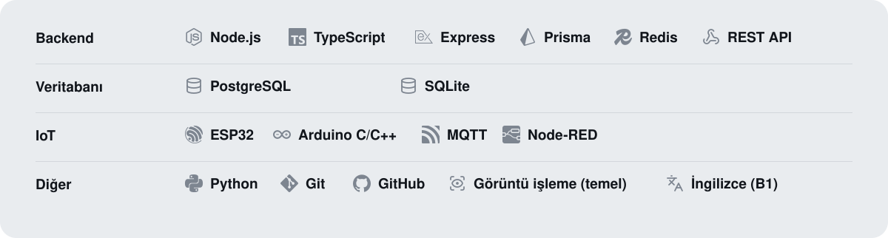

  

Merhaba, ben Mehmed. İstanbul Üniversitesi-Cerrahpaşa'da Bilgisayar Programcılığı okuyorum. Tekrar eden işleri otomatikleştiren ve üretim ortamında çalışan yazılımlar geliştiriyorum.

### Öne çıkan projeler

**[OtoGuard](https://otoguard.tr)**: dijital ürün satan mağazalar için anahtar tabanlı teslimat otomasyonu. Alıcı anahtarı yapıştırır; sistem doğrular, teslimat bilgilerini ve tek kullanımlık doğrulama kodunu birkaç saniyede iletir. Node.js, TypeScript, Prisma, BullMQ ve Redis ile yazdım, canlıda çalışıyor. Kaynak kod özel depoda; istenirse birlikte inceleyebiliriz.

**[social-media-scheduler](https://github.com/mehmedeminkurt/social-media-scheduler) (IWWOMI stajı)**: çok kiracılı sosyal medya zamanlama platformu. Şirket/üyelik veri modeli, OWNER/ADMIN/MEMBER rol tabanlı erişim kontrolü, Instagram ve LinkedIn yayın adaptörleri, AES-256-GCM token şifrelemesi ve PostgreSQL `FOR UPDATE SKIP LOCKED` kuyruğuyla ayrı bir worker süreci. Next.js, TypeScript, Prisma, PostgreSQL ile yazıldı.

**[Canlı simülasyonu dene](https://mehmedeminkurt.github.io)**: anahtarı yapıştır, sunucunun adım adım ne yaptığını izle.

### Teknolojiler

  

### Daha önce

- Eğitim katılımcılarına isimlerine özel sertifika üretip otomatik e-posta gönderen bir program (İHKİB Dijital Dönüşüm Merkezi).
- Node-RED ile barkod tabanlı üretim takibi ve ESP32 ile ürün sayan bir prototip.
- **IWWOMI** projesinde 22 issue kapattım, 38 commit attım, ekip liderinin 4 PR'ını review edip merge ettim.

### Bağlantılar

[Site](https://mehmedeminkurt.github.io) · [LinkedIn](https://www.linkedin.com/in/mehmedeminkurt/) · [E-posta](mailto:mehmedeminkurt9@gmail.com)

English

 

Hi, I'm Mehmed. I study Computer Programming at Istanbul University-Cerrahpaşa and I build software that automates repetitive work and runs in production.

### Featured projects

**[OtoGuard](https://otoguard.tr)** is key-based delivery automation for stores that sell digital products. The buyer pastes a key; the system validates it and delivers the details and a one-time verification code within seconds. Written in Node.js, TypeScript, Prisma, BullMQ and Redis, running in production. The source is in a private repository; happy to walk through it on request.

**[social-media-scheduler](https://github.com/mehmedeminkurt/social-media-scheduler) (IWWOMI internship)** is a multi-tenant social media scheduling platform. It features a company/membership data model, OWNER/ADMIN/MEMBER role-based access control, Instagram and LinkedIn publishing adapters, AES-256-GCM token encryption, and a separate worker process with a PostgreSQL `FOR UPDATE SKIP LOCKED` queue. Built with Next.js, TypeScript, Prisma, and PostgreSQL.

**[Try the live simulation](https://mehmedeminkurt.github.io)** and watch what the server does, step by step.

### Before

- A program that generated personalised certificates and emailed them automatically (İHKİB Digital Transformation Center).
- A barcode-based production tracking system in Node-RED and an ESP32 product-counting prototype.
- **IWWOMI**: closed 22 issues, made 38 commits, and reviewed and merged 4 of the team lead's pull requests.

[Site](https://mehmedeminkurt.github.io) · [LinkedIn](https://www.linkedin.com/in/mehmedeminkurt/) · [Email](mailto:mehmedeminkurt9@gmail.com)

